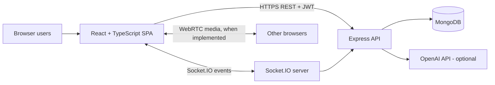
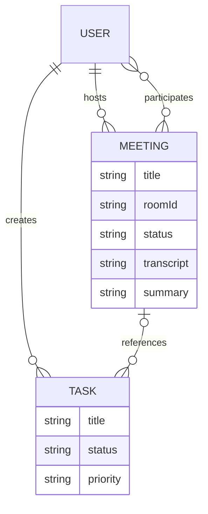

# IntellMeet Architecture

## System context

## Backend modules

- `routes/auth.js`: registration, login and current-user endpoint.
- `routes/meetings.js`: meeting creation, membership, lifecycle and transcript storage.
- `routes/tasks.js`: personal task CRUD and status changes.
- `routes/ai.js`: transcript summary and action-item extraction; demo fallback if no API key is configured.
- `middleware/auth.js`: JWT verification.
- `models/`: Mongoose persistence models.
- `index.js`: HTTP server, Socket.IO events, middleware and health endpoint.

## Main data relationships

## Real-time flow

1. Authenticated browser loads meetings through REST.
2. A participant enters a room; the browser emits `room:join` with the room ID.
3. Socket.IO broadcasts room chat messages to connected sockets.
4. `webrtc:signal` is provided as a signaling relay hook. The current UI does not establish peer connections; implement authenticated signaling plus STUN/TURN and a peer-connection lifecycle before calling this a video-conferencing release.

## Trust boundaries and production hardening

- Enforce authentication and meeting membership for every Socket.IO room event (not yet implemented in this starter).
- Use HTTPS/WSS, strict CORS, short-lived access tokens plus refresh-token rotation, secure cookies where appropriate, and secrets management.
- Use a managed TURN service for reliable WebRTC connectivity.
- Add durable recording/transcription pipelines, consent controls, retention policy and access audit logs.
- Add Redis adapter for Socket.IO horizontal scaling, queues for AI jobs, structured logs, metrics, tracing, backups and load tests.
- Do not claim end-to-end encryption unless media and key management have been independently designed and verified.
